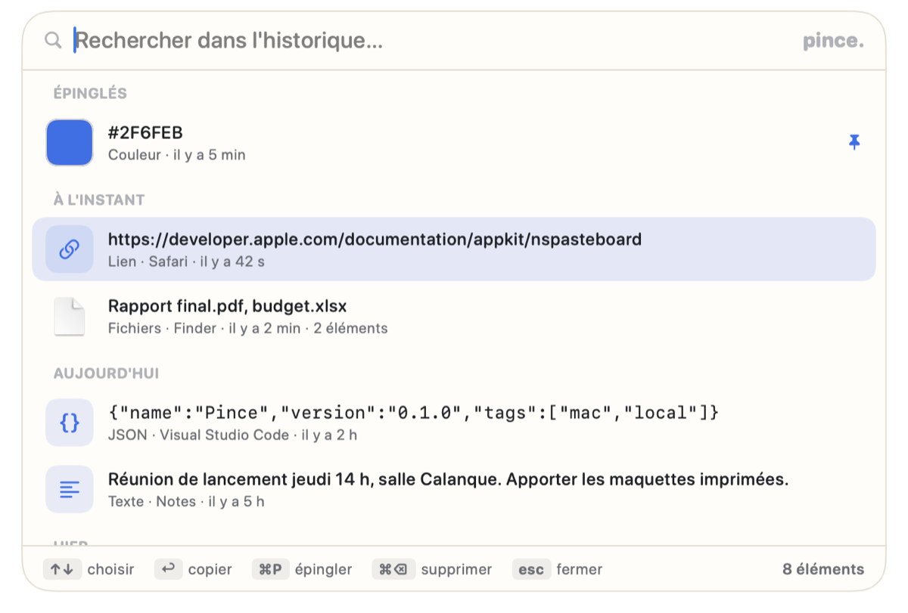
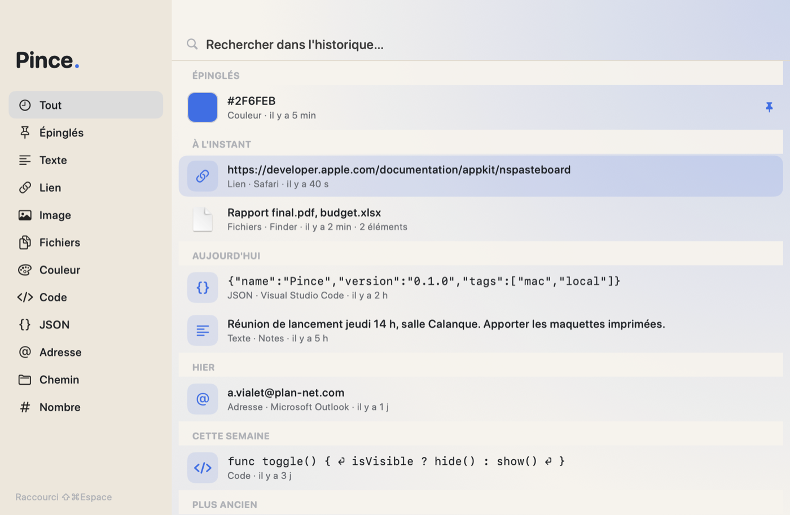

<div align="center">


# Pince

**Gardez plusieurs copies sous la main.**

[](https://github.com/avialet/pince/releases/latest)
[](#installation)
[](LICENSE)

[**Télécharger le DMG**](https://github.com/avialet/pince/releases/latest) · [Site](https://pince.vialet.app)



</div>

## Ce que fait Pince

Le presse-papiers du Mac ne retient qu'une chose. Pince retient tout ce que vous copiez, texte, liens, images, fichiers, et vous le rend en un raccourci.

- **Un raccourci, un panneau, ↩.** ⇧⌘Espace ouvre un panneau par-dessus n'importe quelle app. Tapez quelques lettres, choisissez avec les flèches, ↩ remet l'élément dans le presse-papiers. En option, Pince colle directement dans l'app active.
- **Il reconnaît ce qu'il garde.** Lien, adresse, couleur, JSON, code, chemin, nombre, image, fichiers : chaque copie est reconnue et affichée en conséquence, avec l'app d'origine et l'ancienneté. Une couleur montre sa pastille, un JSON se formate, un lien s'ouvre.
- **Discret et local.** L'historique est un fichier SQLite sur votre Mac, les images sont rangées à côté. Les copies que les gestionnaires de mots de passe marquent confidentielles ne sont jamais enregistrées, et vous pouvez exclure des apps.



## Installation

**Prérequis :** un Mac Apple Silicon sous macOS 26 (Tahoe) ou plus récent.

1. Téléchargez `Pince-X.Y.Z.dmg` depuis la [dernière version](https://github.com/avialet/pince/releases/latest).
2. Ouvrez le DMG et glissez **Pince** dans **Applications**, puis double-cliquez.
3. Au premier lancement, macOS indique qu'il n'a pas pu vérifier l'app (elle est signée
   sans certificat Apple Developer). Cliquez **Terminé** (pas « Placer dans la corbeille »),
   ouvrez **Réglages Système › Confidentialité et sécurité**, descendez jusqu'à
   « Pince a été bloqué… », cliquez **Ouvrir quand même**, authentifiez-vous, puis **Ouvrir**.
   Cette étape n'a lieu qu'une fois par téléchargement. Dans le Terminal :

   ```bash
   xattr -d com.apple.quarantine /Applications/Pince.app
   ```

Pour vérifier le fichier téléchargé, comparez son empreinte avec celle publiée dans la même version :

```bash
shasum -a 256 -c Pince-X.Y.Z.dmg.sha256
```

### Mises à jour

Pince consulte une fois par jour la dernière version publiée sur GitHub. S'il en
existe une plus récente, un clic la télécharge, **vérifie son empreinte SHA-256**, contrôle
l'application qu'elle contient, la remplace et relance l'app. Si une étape échoue, l'app
installée n'est pas touchée. La recherche automatique se désactive dans **Réglages › Mises à jour**.

Le seul échange réseau de Pince est cette lecture de la version publiée. Aucune donnée n'est envoyée.

## Notice

- **⇧⌘Espace** (modifiable dans les Réglages) ouvre le panneau depuis n'importe quelle app. **↑↓** choisir, **↩** copier (ou coller directement si l'option est active), **⌘P** épingler, **⌘⌫** supprimer, **esc** fermer. Un clic ailleurs ferme aussi.
- La **recherche** ignore les accents et la casse : « eleve » trouve « Élève ».
- Les **épingles** restent en tête et survivent au nettoyage de l'historique.
- Une copie identique ne crée pas de doublon : elle remonte en tête.
- La **fenêtre principale** ajoute les filtres par type (liens, images, fichiers, couleurs, code…). L'**icône de la barre des menus** liste les sept dernières copies.
- **Clic droit** sur une entrée : copier, ouvrir le lien, afficher dans le Finder, copier le JSON formaté, épingler, supprimer.
- **Coller directement** (Réglages › Historique) simule ⌘V dans l'app active ; macOS demande l'autorisation d'accessibilité une seule fois. Sans l'option, ↩ copie et vous collez vous-même.
- Fermer la fenêtre ne quitte pas l'app : le raccourci et l'icône de la barre des menus restent actifs. **⌘Q** quitte vraiment.

### Vos données

```text
~/Library/Application Support/Pince/pince.sqlite      # textes, liens, chemins, metadonnees
~/Library/Application Support/Pince/images/           # images copiees, en PNG
```

Pour sauvegarder, copiez ce dossier. Pour repartir de zéro, quittez l'app et supprimez-le. Dans les Réglages, l'historique se limite à 100, 500 ou 2 000 éléments (500 par défaut), et « Effacer l'historique » garde les épingles.

## Compiler depuis les sources

Il faut Swift 6.3 ou plus récent (les Command Line Tools suffisent, Xcode n'est pas nécessaire).

```bash
git clone https://github.com/avialet/pince.git
cd pince
make test      # tests du noyau
make run       # construit et lance l'app
make install   # installe dans /Applications
make release   # fabrique build/Pince-X.Y.Z.dmg et son empreinte
```

| Dossier | Contenu |
|---|---|
| `Packages/PinceCore` | Noyau sans interface : détection du contenu, historique SQLite ([GRDB](https://github.com/groue/GRDB.swift)), recherche, épingles |
| `Pince` | L'application SwiftUI ; `App/Brand.swift` porte son identité |
| `scripts` | Assemblage de l'app, du DMG et de l'icône |
| `docs` | [Publier une version](docs/publier-une-version.md), [tests](docs/tests.md), notes de version |

Le socle commun (mises à jour, thème, raccourci global, panneau flottant) vient de
[VialetKit](https://github.com/avialet/vialetkit). Publier une version ne demande que de
modifier `VERSION` puis de pousser un tag `vX.Y.Z` : la CI construit et publie le DMG, et
les utilisateurs reçoivent la mise à jour dans l'app.

## Confidentialité

Pince ne collecte rien. Vos données ne quittent jamais votre Mac. La seule requête
réseau est la lecture de la dernière version publiée sur GitHub, que vous pouvez désactiver.

## Licence

[MIT](LICENSE) © 2026 Aurélien Vialet
